# ANSIpants

**Retro text art for the future.** An ANSI and ASCII art editor for iPad, iPhone and Mac, with free terminal editions for Linux and macOS, and a browser edition that runs offline.

<p align="center">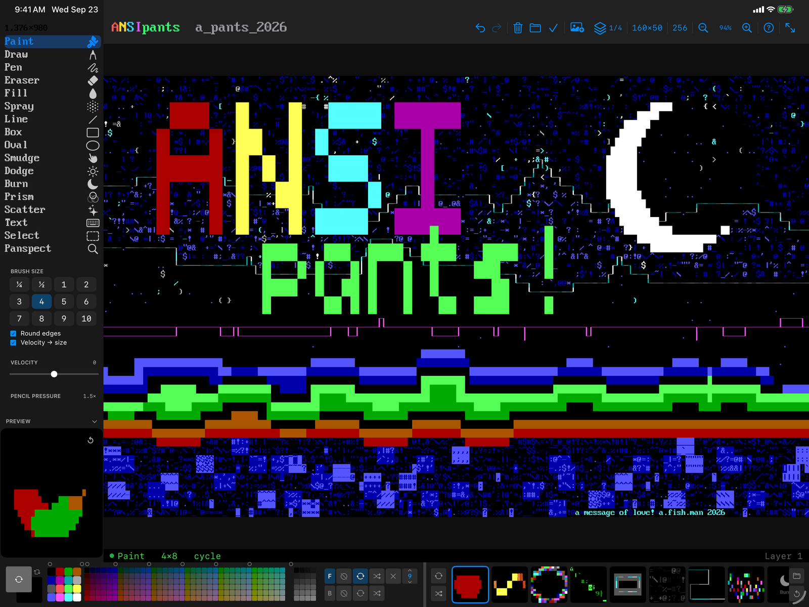</p>

> **There is no source code in this repository.** ANSIpants is closed source for now. This is its public home: releases of the terminal editions, the issue tracker, and the manual below. Everything else lives at **[ansipants.com](https://ansipants.com)**.
>
> Not related to `demozoo/ansipants` (a Python `.ans` to HTML converter) or `glhd/ansipants`. Same word, different things.

## Terminal editions: download

Current: **ANSIpants16M 2.0.2 (43)** and **ANSIpants16 2.0.2 (37)**. The tarballs are attached to the [latest release](https://github.com/tungusk/ansipants/releases/latest) and served from [ansipants.com](https://ansipants.com/#download); the checksums are the same in both places. Install notes are under Getting started below; on macOS, clear Gatekeeper's quarantine first with `xattr -d com.apple.quarantine ansipants16m-macos*.tar.gz`, or use System Settings → Privacy & Security → Open Anyway.

| | |
|---|---|
| 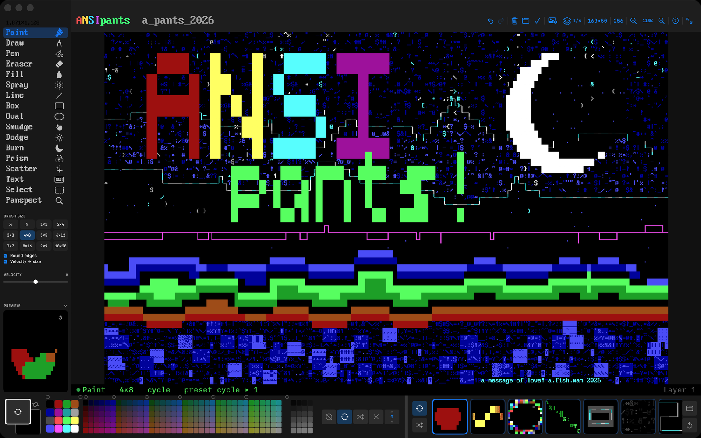 | 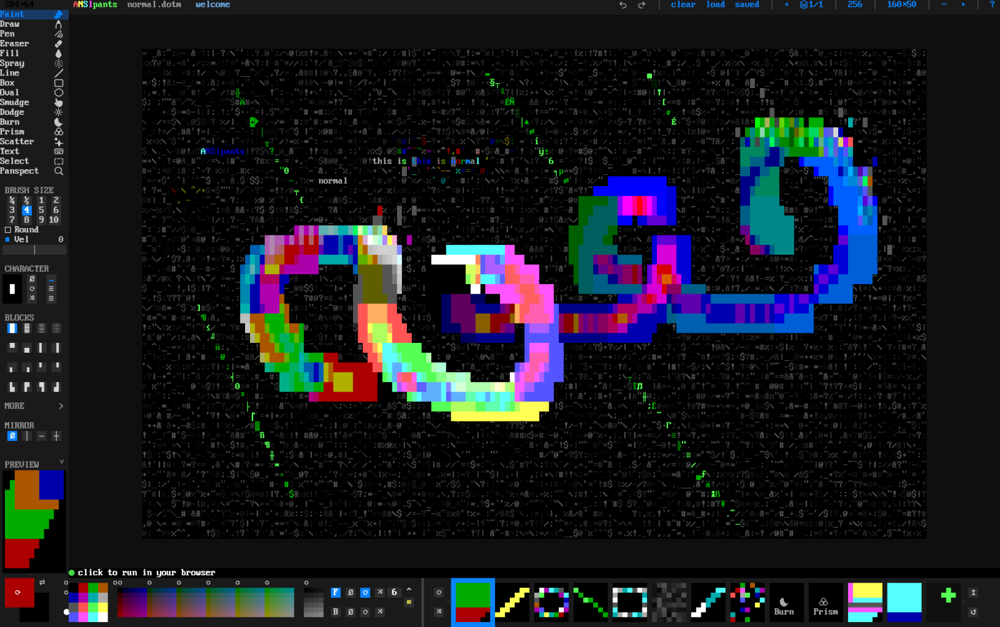 |
| 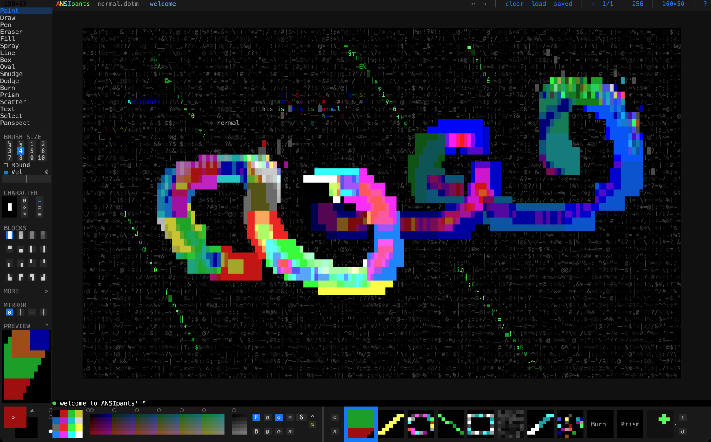 | 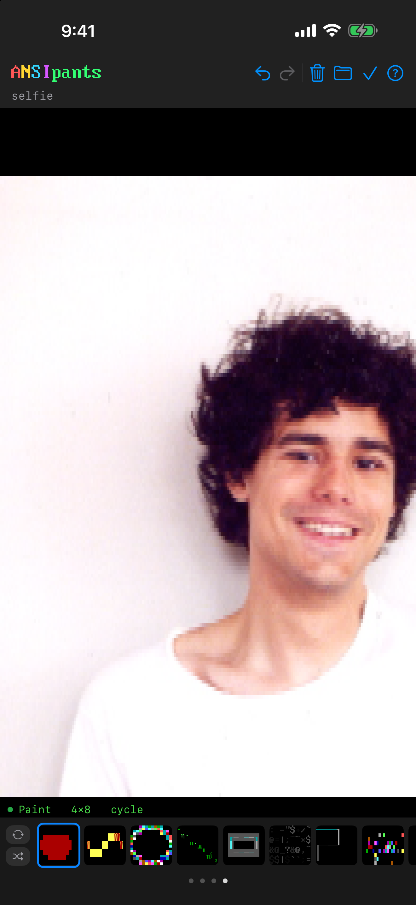 |

# The manual

Updated Oct 18, 2026. The file formats are documented in [FILE_FORMATS.md](FILE_FORMATS.md).

## Welcome

ANSIpants is a paint program for ANSI and ASCII art: pictures built from text characters and colors. Every mark you make is a character in a cell, with a foreground color and a background color. Draw something, and undo is always there if you change your mind.

ANSIpants comes in four editions. They share one file format, so a drawing made in one opens in the others.

| Edition | Runs on | Colors and characters | Get it |
| --- | --- | --- | --- |
| **ANSIpants app** | iPhone, iPad, Mac | Up to full truecolor, Unicode | App Store |
| **ANSIpants16M** | Any terminal on Mac, Linux, or Windows (WSL) | Up to full truecolor, Unicode | Download, or run it in your browser |
| **ANSIpants16** | Any terminal on Mac, Linux, or Windows (WSL) | The classic 16 colors and the original PC character set (CP437) | Download, or run it in your browser |
| **Browser editions** | Any modern browser, including phones and tablets | Same as 16M or 16 | Just open the link |

**Which should I pick?** To try it right now, open the browser edition. For a touch screen or Apple Pencil, get the app. If you live in a terminal, or want to draw over ssh, install 16M. If you like working inside the original 1990s limits, use 16: everything you make with it is legal by classic art-pack rules.

This manual follows 16M (and the browser edition, which is 16M). The app does the same things with its own buttons, and notes mark where it differs.

## Getting started

### In your browser

Open [ansipants.com/web](https://ansipants.com/web/) for 16M, or [ansipants.com/16/web](https://ansipants.com/16/web/) for 16. The first visit downloads the program once, then it starts from your browser's cache. Files you save stay in that browser, and survive closing the tab.

### In a terminal

Download the archive for your system from [ansipants.com](https://ansipants.com/), then unpack and install it:

```
tar -xzf ansipants16m-macos*.tar.gz && ./install.sh && ansipants
```

On Linux, use the `ansipants16m-linux-*.tar.gz` archive with the same command. Mac builds run on macOS 11 or later (Apple Silicon) and 10.14.4 or later (Intel). On Windows, use the Linux build under WSL.

ANSIpants wants a terminal with mouse support and truecolor, such as iTerm2, kitty, or xterm. A terminal of at least 160×50 shows a 160×50 canvas with room for the controls. Smaller windows still work: the controls tuck away to give the canvas room.

To open a file at launch, name it: `ansipants mydrawing.ans`. Run `ansipants --help` for every option, such as `--size 80x25` for a classic-size canvas.

### Your first drawing

When ANSIpants opens, the first preset is loaded: Paint with a big brush, a full block, and a foreground that cycles through all 16 colors. Your first strokes come out as a rainbow. Picking a tool or a color yourself changes that.

1. **Scribble.** Drag across the canvas a few times. The color steps along as you go.
2. **Pick a tool.** Click Paint in the tool list. From now on, your choices stick.
3. **Pick colors.** Click a color chip along the bottom for the foreground. Right-click a chip to set the background.
4. **Change the character.** Click the character button in the sidebar and pick a block such as `▓` or `█`, or any other glyph.
5. **Try a shape.** Click Box and drag out a rectangle. Release to place it.
6. **Undo.** Press Ctrl-Z. Ctrl-Y brings it back.
7. **Save.** Click the ✓ in the top bar. Click the filename first if you want to rename it.

Click `?` in the top bar at any time for a quick sheet of keys and mouse actions. Its last line opens the tutorial, a nine-page tour.

### The tutorial

A short built-in tutorial walks through the ideas behind the editor in nine pages: why characters aren't square, the three parts of every cell, the tools, color depth, layers and presets, SAUCE, and saving. Click `?` in the top bar and choose **tutorial** at the foot of the key sheet. Arrow keys, Enter or Space turn the pages, and Esc closes it.

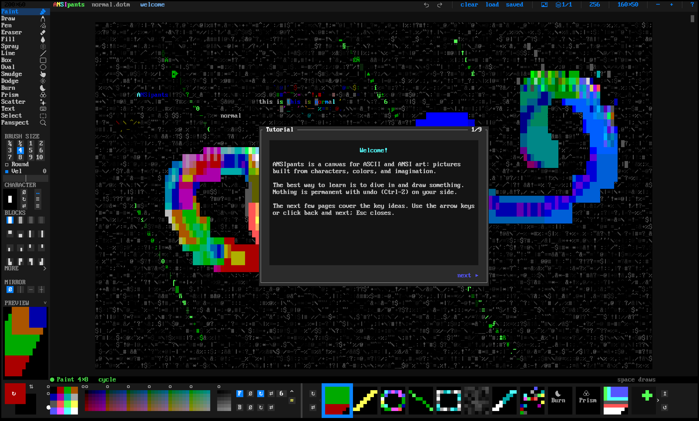

## The screen

The canvas sits in the middle. The tools are down the left, the file controls along the top, and the colors and presets along the bottom. **Hover over anything and the status row names it**, so when in doubt, point at it.

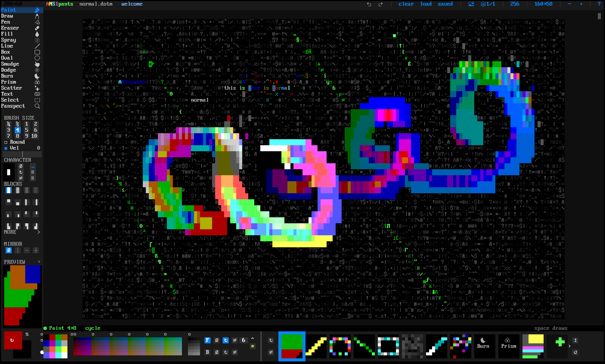

- **Top bar.** The ANSIpants title (click it for the About window), your file's name (click to rename it), and buttons for undo, redo, save (✓), clear, open, layers, canvas size and color depth.
- **Sidebar.** The tool list, then the current tool's options under it: brush size, line style, fill settings and so on. **Click the selected tool a second time** to open a panel with the rest of its options. The mirror switch sits at the bottom.
- **Canvas.** Your drawing. If it's bigger than the window, the Panspect tool drags it around.
- **Color bar.** The foreground and background squares (click to swap them), the color chips, and the mode buttons `0` `*` `%` for each (see Colors).
- **Preset strip.** Your saved tool setups. Click one to load it. When the window is short, colors and presets share one row, with a switch between them.
- **Status row.** Says what you're pointing at, or what just happened. Click it to unroll a short history of recent actions.

In a small window (80×25 or so), ANSIpants goes compact: the status row and some padding give way to the canvas, and tool options move behind the second click.

**In the browser,** the About window also holds the text size settings: automatic sizing that fits the canvas to the window, or `−` and `+` to set it yourself.

**In the app,** the same parts are arranged for touch. On iPhone, the Toolbox (the wrench) holds the character picker, colors, tool settings, presets and canvas size in one sheet. Turn the phone sideways for a full-screen canvas with a floating toolbar.

**On a big window,** 16M switches to a doubled layout on its own: a wider sidebar, a taller color bar with full-size preset chips, and every panel and menu drawn at twice the size. It happens when the terminal is around 220 columns by 90 rows or more, which is what you get by zooming a terminal out, or by making the browser window large. The drawing itself stays one cell per cell, so a big window shows more of your art, not bigger art. Nothing to switch on; make the window smaller and it goes back.

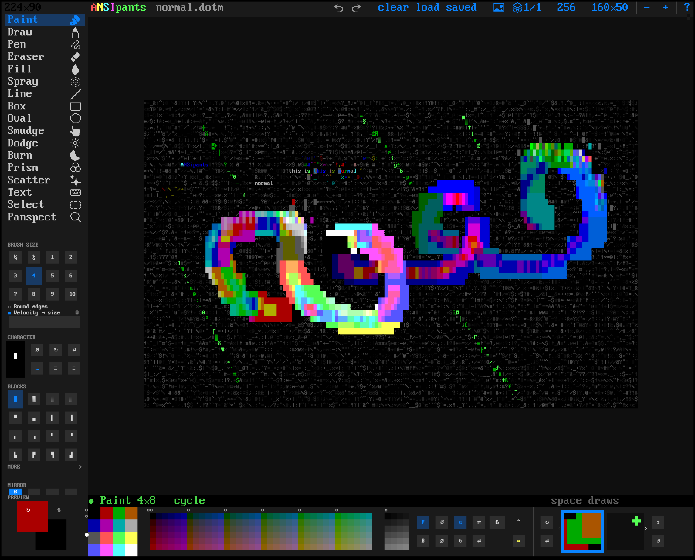

## Colors

Every cell has two colors: the **foreground** (the character's own color) and the **background** (the color behind it). A full block `█` shows only its foreground. A space shows only its background.

### Picking colors

- **Left-click a chip** to set the foreground. **Right-click a chip** to set the background.
- **Click either square** at the left of the color bar to swap foreground and background.
- **Right-click on the canvas** to paint with the two swapped for that stroke. It's the quick way to lay down background color.
- At 256 colors and above, the picker opens with sliders for red, green, blue and brightness. Click a number to type an exact value.
- The Panspect tool eyedrops: click a cell to take its colors.

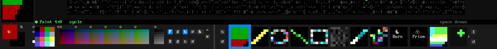

### Null: leave it alone (ø)

Either color can be set to null, shown as ø. A null color means "don't touch this". With the foreground at ø, painting changes the characters and backgrounds but keeps every cell's existing foreground. With the background at ø, your strokes keep whatever ground is already showing. The character can be null too, which recolors without changing what's drawn.

### Solid, cycle, random

The foreground, the background and the character each have three modes:

| Button | Mode | What a stroke does |
| --- | --- | --- |
| `0` | Solid | Uses the one color or character you picked |
| `*` | Cycle | Steps through your chosen set in order as you paint |
| `%` | Random | Picks from your chosen set at random, over and over as you paint |

In cycle or random, clicking chips adds them to or removes them from the set. Cycle has extra settings: how many cells each color lasts, the direction, and whether each stroke starts over.

### Color depth

The depth button in the top bar sets how many colors the drawing may use:

| Depth | Colors | Good for |
| --- | --- | --- |
| Mono | Three tones: off, normal, bright | Monochrome-screen looks |
| 16 | The 16 classic PC colors | Classic ANSI art, the most portable |
| 256 | The xterm 256-color palette | Smoother shading in most terminals |
| 16M | Any color (truecolor) | Full-color pictures |

Narrowing the depth doesn't change what you've drawn. New colors are kept inside the depth, and the **Conform** button snaps the existing art to it when you're ready (undoable).

The same menu holds the **character set** (Unicode, the original PC set CP437, or plain ASCII) and **blinking text**. Classic PCs used one bit for either a bright background or a blinking foreground, never both. Turn blinking on, and the foreground can flash, but backgrounds are limited to the 8 darker colors.

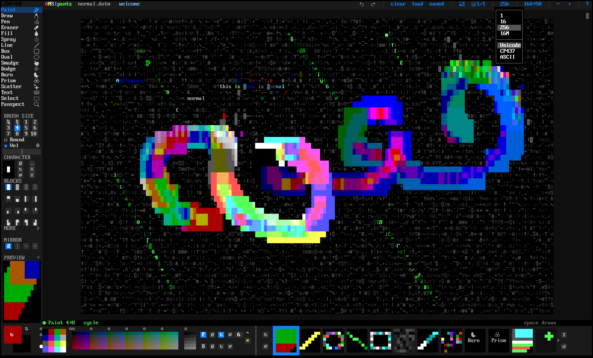

## Tools

16M has 17 tools. Click a tool to pick it, and click it again for its full options.

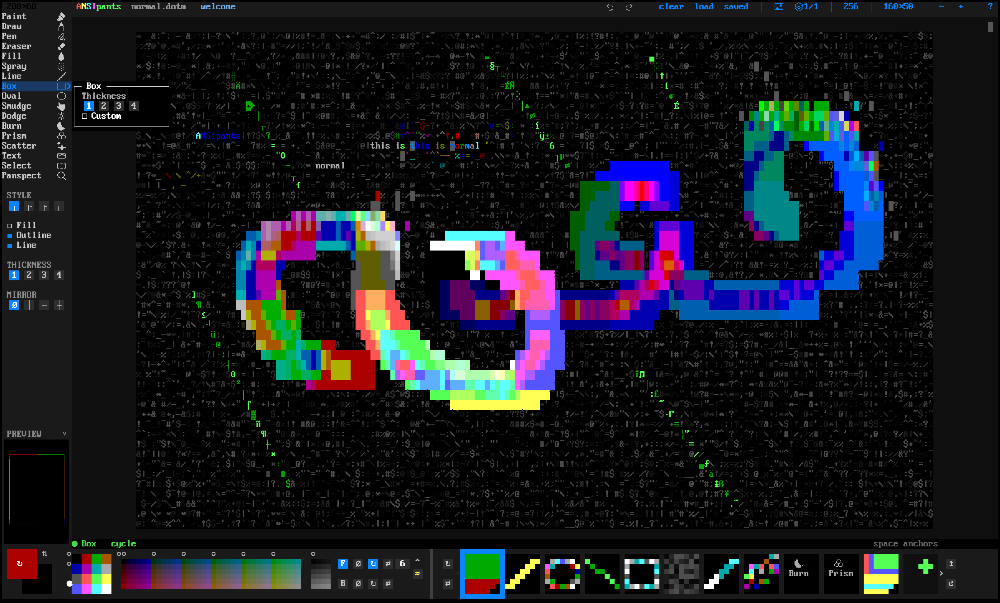

| Tool | What it does |
| --- | --- |
| **Paint** | Brush strokes in your character and colors |
| **Draw** | Shades by speed: slow strokes lay `█`, fast ones `░`, with `▓` and `▒` between |
| **Pen** | Smart box-drawing lines whose corners and crossings join up by themselves |
| **Eraser** | Clears cells back to blank |
| **Fill** | Floods a region. Choose whether it matches on character, foreground or background, or fill with a gradient |
| **Spray** | Scatters your character around a radius |
| **Line** | Straight lines: press, drag, release |
| **Box** | Rectangles in single, double or mixed box-drawing lines, outlined, filled or both |
| **Oval** | Ellipses in characters, half-blocks or lines |
| **Smudge** | Drags existing art along the stroke. Choose which of character, foreground and background travel |
| **Dodge** | Lightens what you stroke |
| **Burn** | Darkens what you stroke |
| **Prism** | Shifts the hue as you stroke |
| **Scatter** | Jitters cells and colors around |
| **Text** | Click to place a cursor and type. F1–F10 stamp special glyphs |
| **Select** | Drag out a region, then copy, cut, fill, or paste it elsewhere |
| **Panspect** | Inspects a cell, eyedrops its colors on click, and drags the view around |

### Brushes

Paint, Draw, Eraser and Smudge share brush sizes from ½ and ¼ of a cell up to 8.

- **Characters are about twice as tall as wide.** So even sizes are twice as wide as tall, to come out square. Odd sizes cover an equal number of rows and columns, so they look taller than wide.
- **Half and quarter brushes** paint with half-block and quarter-block characters, for twice the detail. Strokes that overlap merge: `▀` plus `▄` makes `█`.
- **Round** clips the corners off bigger brushes. **Velocity** makes the brush smaller as you move faster.

### Shapes

Line, Box, Oval and Select show a preview while you drag and place on release. Press Esc mid-drag to cancel. Box and Oval can fill their inside with a separate character and colors of their own: look for the custom fill in their options. Shape tools correct for the tall cells, so a circle comes out round.

### Mirror

The mirror switch at the bottom of the sidebar echoes every stroke across the canvas: off, left–right, top–bottom, or into all four corners.

### Keyboard drawing

The arrow keys move a cursor on the canvas. Press Space to put the pen down and draw with the arrows, or to anchor and commit a shape. With the Text tool, Enter starts a new line under where you began, and Backspace erases to the left.

## Characters, layers and presets

### Characters

The character button in the sidebar opens the picker. It shows the glyphs of your document's character set: the full Unicode range, the original PC set (CP437), or plain ASCII. Blocks (`█▓▒░▀▄▌▐`) and box-drawing lines are the classic building materials.

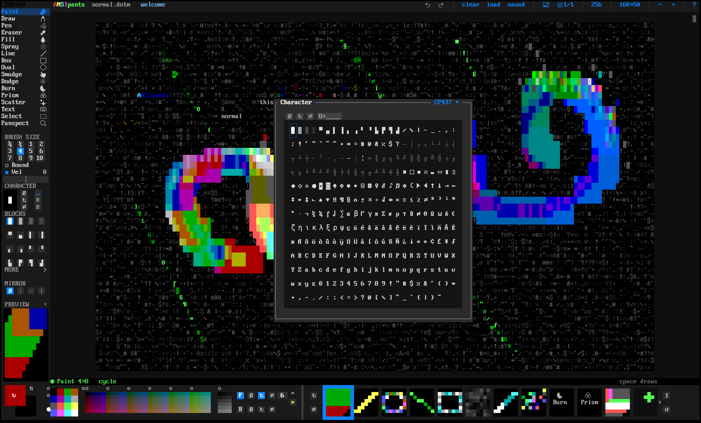

The **F-key banks** keep ten glyphs at your fingertips. With the Text tool, F1–F10 stamp the current bank's glyphs, and F11 and F12 switch banks.

### Layers

The layers button in the top bar opens the stack. A drawing can have up to 7 layers.

- **Add** puts a new layer above the active one. Layers can be moved up and down, hidden, and deleted.
- **Where you see through.** A blank cell (a space on black) is see-through, and shows the layers below. Anything else covers them, including a space on any other color.
- **Shift** moves a whole layer: turn it on, then use the arrow keys to nudge the layer, or drag it on the canvas. Press 0 to put it back.
- **Flatten** merges every visible layer into one (undoable).

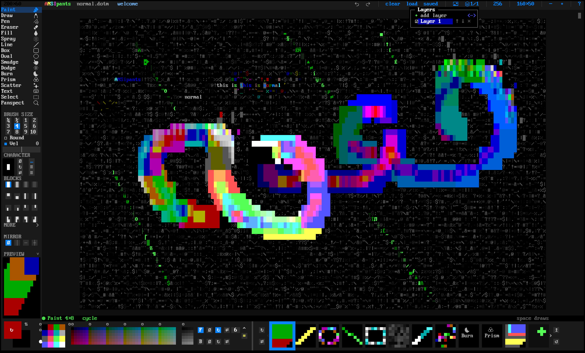

Layers are saved only in the `.ansipants` format. Saving as `.ans` writes the flattened picture.

### Presets

A preset is a saved tool setup: the tool, brush, character, colors and modes, all in one click. ANSIpants starts with twelve built in.

- **Click a preset** to load it.
- **Capture** (the `+`) saves your current setup as a new preset. Delete a preset with its `−`, then click again to confirm.
- **Cycle and random.** Like colors, the preset strip has `*` and `%` modes. In cycle mode, each stroke uses the next preset; in random mode, a random one. Try it for a quick tour of what the program can do. Picking a tool yourself turns it off.
- **Share them.** The bank menu saves your presets to a `.ansipresets` file or loads one, adding to yours or replacing them. You can always reset to the built-in twelve.

Presets also travel inside `.ansipants` files, so a drawing carries the tools it was made with.

## Saving and exporting

Click the ✓ in the top bar to save. Click the filename first to rename the drawing; pressing Enter there also saves. ANSIpants never overwrites a different file of the same name: it adds `-1`, `-2` and so on instead.

### What gets written

| File | When | What it's for |
| --- | --- | --- |
| `.ans` | Every save | The classic ANSI art file: the picture as text and color codes, with a SAUCE record. Opens in any ANSI viewer |
| `.ansipants` | When the drawing has more than one layer, or you choose it | Everything: every layer, the presets, the document settings. Opens in all ANSIpants editions |
| `.utf8.ans` | If turned on | The same picture in UTF-8, so it shows in any modern terminal with `cat` |
| `.png` | If turned on | A picture of the art, drawn in the authentic VGA font |
| `.1080.png` | If turned on | That picture framed in a 1080-pixel-high frame, ready to share |
| `.txt` | If turned on | The characters only, no color |

The extra files are set in the save options: click the ✓ after a save to open them. Ctrl-E exports a PNG at any time.

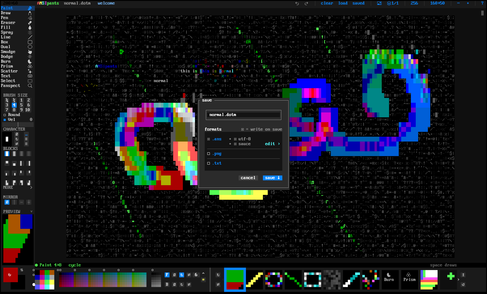

**In the browser,** saving can also download the file to your computer. If you've asked for extra files, they come together in one zip. Your files are also kept inside the browser; the open button lists them, with a `−` to delete any you don't need.

### Opening

The open button lists `.ans` and `.ansipants` files. In the browser, the upload button copies files in from your computer. From a terminal, you can also name a file when you start: `ansipants art.ans`.

### Importing a picture

The picture button in the top bar turns a photo or drawing into text art. It lists your pictures newest first with the latest one already selected, so the file you just added is at the top. One click selects a picture, and a double-click, Enter, or the **import ›** button opens it. In the browser, **import from your computer…** adds a picture from your disk first.

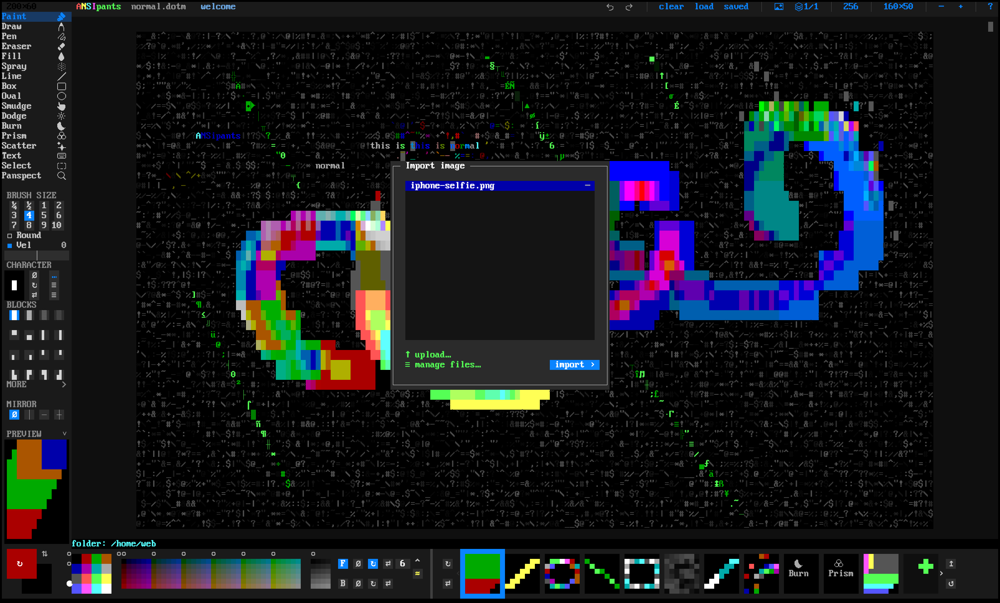

The picture appears over the canvas as a live preview, and a panel of styles and sliders shapes it:

| Row | Styles | What they make |
| --- | --- | --- |
| Blocks | Half, Quad, Sext, Oct | Pixel art in block characters, from two pixels per cell up to eight |
| Text | Ink, Glyph, Words, Braille | Characters on black, where darker glyphs stand for darker pixels; Words sets the picture in your own text |
| Lines | Lines, Outline | Edges traced in line characters, with the bodies filled |
| Color | ANSI, Shade, FG, BG | Color-first conversions in the document's color depth |

Size runs from 10% to 400%, and Brightness, Contrast and Saturation do what they say. Lines adds an Edge slider and Ink a Weight slider. Drag the preview to move it around the canvas. Styles your document can't show, such as Quad in an ASCII document, are greyed with a reason when you hover. **Apply** (or Enter) places the result on the canvas; **Cancel** (or Esc) leaves it as it was.

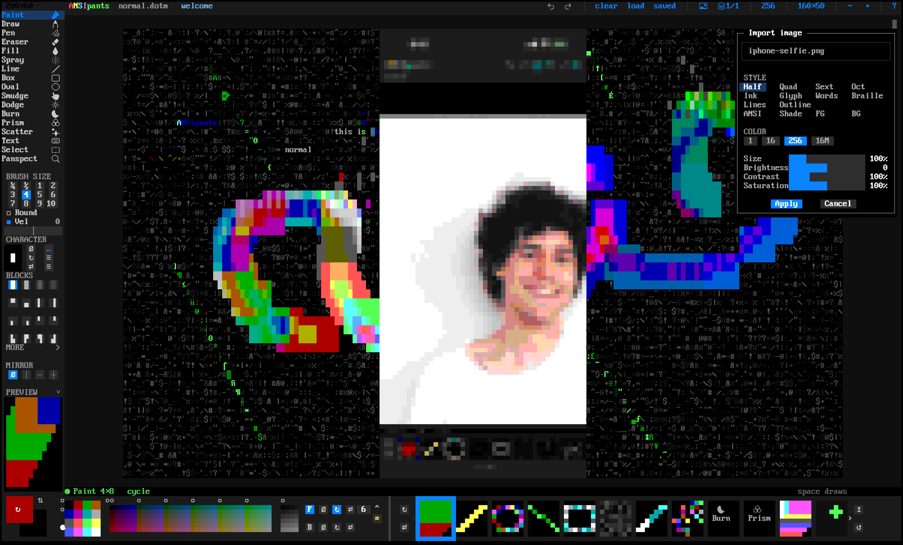

### SAUCE: your name on your art

A `.ans` file ends with a small hidden record called SAUCE, a standard from 1994. It holds the title, the artist, the group, the date, and how the art should be displayed (its width and font). Viewers read it, and art collections use it to credit the artist.

- Fill in your handle (up to 20 characters) and a title in the SAUCE settings of the save options. The date is set when you save.
- **Open art someone else signed, and their name stays on it.** ANSIpants won't quietly replace their credit with yours. The record shows as signed by someone else. Editing it means you're claiming the work.

## Keys and shortcuts

Click `?` in the top bar for this list on screen, and for the tutorial.

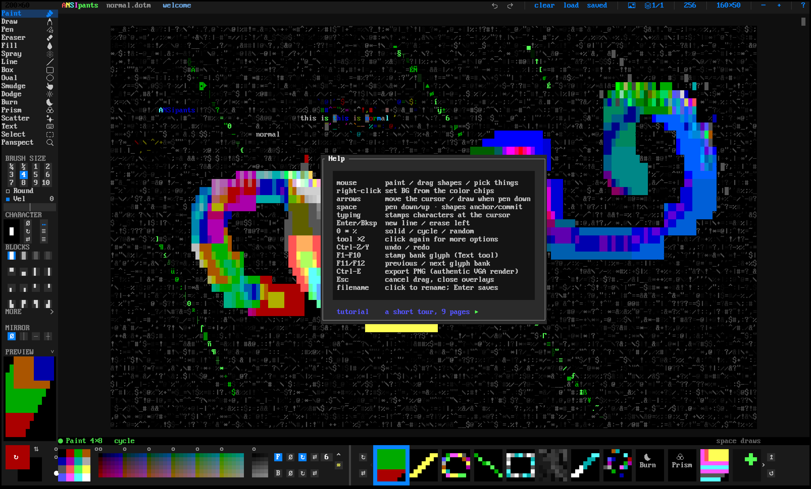

| Key | What it does |
| --- | --- |
| Mouse | Paint, drag shapes, click controls |
| Right-click | On a chip: set the background. On the canvas: paint with the colors swapped |
| Click the selected tool | Open its full options |
| Arrow keys | Move the cursor; draw when the pen is down |
| Space | Pen down or up; anchor or commit a shape |
| Typing | Stamps characters at the cursor |
| Enter / Backspace | New line / erase to the left |
| Tab | Text tool: stamp the current character as a block |
| `0` `*` `%` | Solid, cycle, random |
| Ctrl-Z / Ctrl-Y | Undo / redo |
| Ctrl-V | Float the copied selection again, ready to place |
| Ctrl-E | Export a PNG in the VGA font |
| F1–F10 | Text tool: stamp a glyph from the current bank |
| F11 / F12 | Previous / next glyph bank |
| Esc | Cancel a drag, close a panel |
| Ctrl-L | Redraw the whole screen |
| `?` | Top-bar button: the key sheet, with the tutorial at its foot |
| Ctrl-C or Ctrl-Q | Quit: press once to arm, again to confirm |

## Source

Closed for now. Don't worry, we'll probably open the source some day; until then the author wants to keep control of where it goes. Bugs and ideas are welcome in the [issues](https://github.com/tungusk/ansipants/issues).

## Author

Arlo Fishman · [ansipants.com](https://ansipants.com) · [privacy policy](https://ansipants.com/privacy.html)

© 2026 Arlo Fishman. The screenshots in `media/` may be reused to write about ANSIpants.
